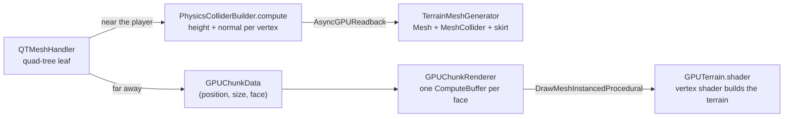

<h1 align="center">Quad-Tree Planet</h1>

<p align="center">
  <em>A whole procedurally generated planet you can walk on, with level of detail from kilometer-wide continents down to 1-meter ground detail, and terrain meshes generated on the GPU.</em>
</p>

<p align="center">
  
  
  
  
</p>

<!--
  Hero image: add a screenshot at docs/screenshots/ and uncomment.
<p align="center">
  
</p>
-->

---

## Table of Contents

- [About](#about)
- [From Space Ship Driver to Quad-Tree Planet](#from-space-ship-driver-to-quad-tree-planet)
- [Technical Highlights](#technical-highlights)
  - [Quad-Tree Level of Detail on a Cube-Sphere](#1-quad-tree-level-of-detail-on-a-cube-sphere)
  - [GPU Integration in Mesh Generation](#2-gpu-integration-in-mesh-generation)
  - [Lighting and Normals on a Curved Surface](#3-lighting-and-normals-on-a-curved-surface)
  - [Planet-Scale Terrain Map](#4-planet-scale-terrain-map-compute-shader)
  - [Walking on a Round Planet](#5-walking-on-a-round-planet)
- [Project Structure](#project-structure)
- [Getting Started](#getting-started)
- [Roadmap](#roadmap)
- [Sources and Credits](#sources-and-credits)

---

## About

Quad-Tree Planet is a fork of **[Space Ship Driver](https://github.com/murpduff/space-ship-driver)**, my procedural terrain and graphics programming project in Unity. Space Ship Driver generates flat terrain that stretches tens of kilometers into the distance. This project takes the next step: **an entire planet the player can explore**, generated around them as they move.

It covers:

- **A quad-tree level-of-detail (LOD) system** on a cube-sphere. Terrain near the player is subdivided down to 1-meter vertex spacing, while the far side of the planet is drawn with only a handful of large chunks.
- **GPU integration in mesh generation.** Distant terrain is built entirely in a vertex shader using GPU instancing, and nearby terrain gets its heights and normals from a compute shader before becoming a physics mesh.
- **Lighting on a curved surface:** per-pixel normals computed from the noise gradient, rotated into the planet's local tangent frame, so even low-resolution distant chunks are lit with fine detail at almost no extra cost.
- **Spherical gravity**, so the player can walk all the way around the planet.

My goal is a to-scale planet that someone can explore, with every small detail on it reflecting my appreciation of the real world.

> **Status:** work in progress. This fork focuses on terrain generation so far. The Rayleigh-scattering atmosphere from Space Ship Driver ([see its README](https://github.com/murpduff/space-ship-driver#1-atmospheric-scattering-rayleigh)) hasn't been ported to the planet yet.

---

## From Space Ship Driver to Quad-Tree Planet

| | Space Ship Driver | Quad-Tree Planet |
|---|---|---|
| **World shape** | Flat grid of chunks centered on the player | Cube projected onto a sphere (6 faces) |
| **Level of detail** | Each chunk picks a resolution from its distance | Chunks recursively split into 4 children as the player approaches, and merge as they leave |
| **Mesh generation** | CPU, multithreaded with Jobs + Burst | GPU: vertex shader for far chunks, compute shader for near chunks |
| **Planet data** | GPU planet texture read back to seed the flat terrain | Noise is evaluated directly on the sphere's surface |
| **Player** | Supersonic jet | Walking character with spherical gravity |

---

<!--
  Screenshots: add images to docs/screenshots/, uncomment this section,
  and add "- [Screenshots](#screenshots)" to the Table of Contents.

## Screenshots

| | |
|:---:|:---:|
|  |  |
| **From orbit:** the whole planet, drawn mostly by GPU-instanced chunks | **On the surface:** high-detail chunks with physics colliders |
|  |  |
| **Quad-tree LOD:** chunk size doubles with each step away from the player | **Curved horizon:** the terrain wraps around a sphere |

---
-->

## Technical Highlights

With a 12-level quad tree (`maxBranch = 12`), the planet has a radius of about **57 km**. The finest chunks are 16 m across with 1 m between vertices; each cube face at the root of the tree is 65.5 km across.

### 1. Quad-Tree Level of Detail on a Cube-Sphere

| File | Role |
|---|---|
| [`Assets/Scripts/Terrain/QTMeshHandler.cs`](Assets/Scripts/Terrain/QTMeshHandler.cs) | Builds and walks the quad tree on all 6 cube faces, decides which chunks to split or merge, and routes each leaf chunk to the GPU or physics pipeline |
| [`Assets/Scripts/Terrain/QTTrigger.cs`](Assets/Scripts/Terrain/QTTrigger.cs) | Rebuilds the tree only after the player has moved a minimum distance, instead of every frame |

**How it works:**

1. **Cube-sphere:** the planet starts as 6 root chunks, one per face of a cube. The planet radius is set to half of the cube's diagonal (`worldScale * √3 / 2`), so every point on the cube is pushed outward onto the sphere.
2. **Split test:** each chunk's distance to the player is measured *in units of its own size*. If that distance falls under the `rangeByBranch` curve, the chunk splits into 4 children, each half as wide. This repeats down the tree, so detail concentrates around the player:
   ```csharp
   float dstToCenter = Vector3.Distance(player.position / meshSize, GetChunkCenter(chunk)) / scale;

   if (dstToCenter <= rangeByBranch.Evaluate((float)chunk.branch / maxBranch) && chunk.branch > 0) {
       // split into 4 children
   }
   ```
   (Simplified: close to the ground, the distance is measured from the point on the sphere below the player, so jumping doesn't change the LOD.)
3. **Scale:** each extra level (`maxBranch`) doubles the planet's radius while keeping 1 m detail at the player's feet.
4. **No holes during LOD changes:** when chunks split or merge, the old meshes stay visible in a `PendingSwap` until their replacements have finished generating, and only then are they destroyed.
5. **Skirts:** each chunk has an extra ring of vertices along its edge that drops below the surface, hiding the cracks between neighboring chunks at different resolutions.

---

### 2. GPU Integration in Mesh Generation

Every leaf of the quad tree goes down one of two GPU pipelines. Small chunks near the player (`branch ≤ physicsBranchThreshold`) need colliders, so they become real meshes. Everything else is drawn directly by the GPU and never exists as a mesh on the CPU.



#### Far terrain: built entirely on the GPU

| File | Role |
|---|---|
| [`Assets/Scripts/Terrain/GPUChunkRenderer.cs`](Assets/Scripts/Terrain/GPUChunkRenderer.cs) | Uploads a list of 20-byte chunk descriptions to a `ComputeBuffer` per cube face and draws them all with one instanced draw call per face |
| [`Assets/Scripts/Terrain/GPUTerrain.shader`](Assets/Scripts/Terrain/GPUTerrain.shader) | Vertex shader that turns a shared flat grid into spherical, noise-displaced terrain for each instance; fragment shader computes per-pixel normals |

- **One mesh, reused for every chunk:** a single flat grid is generated per cube face at startup. Each far chunk is just a position, a size and a face ID, so the CPU never builds vertices, triangles or GameObjects for distant terrain.
- **At most 6 draw calls** for the far terrain, no matter how many chunks there are:
  ```csharp
  Graphics.DrawMeshInstancedProcedural(baseGridMeshes[i], 0, gpuTerrainMat, planetBounds, activeCounts[i], propertyBlock);
  ```
- **The vertex shader does the mesh generation.** It reads its chunk from the buffer using the instance ID, scales and places the grid on the cube face, projects it onto the sphere, and pushes it outward by the noise height:
  ```hlsl
  GPUChunkData chunk    = _ChunkBuffer[instanceID];
  float3 cubeFacePos    = input.positionOS.xyz * chunk.size / _MeshSize + chunk.center;
  float3 sphereWorldPos = cubeFacePos + Spherify(cubeFacePos, chunk.size);          // cube -> sphere
  float3 sphereNormal   = normalize(sphereWorldPos - _PlanetCenter);
  float3 planetWorldPos = sphereWorldPos + sphereNormal * GetHeight(sphereWorldPos); // add terrain
  ```
- **Noise LOD:** far chunks evaluate fewer noise octaves (`gpuOctaves`) than near chunks, since the finest details can't be seen at a distance.

#### Near terrain: compute shader + async readback

| File | Role |
|---|---|
| [`Assets/Scripts/Terrain/PhysicsColliderBuilder.compute`](Assets/Scripts/Terrain/PhysicsColliderBuilder.compute) | One GPU thread per vertex (8×8 thread groups) computes the terrain height and surface normal |
| [`Assets/Scripts/Terrain/TerrainMeshGenerator.cs`](Assets/Scripts/Terrain/TerrainMeshGenerator.cs) | Dispatches the compute shader, reads the results back with `AsyncGPUReadback`, and builds the `Mesh`, `MeshCollider` and skirt |

- **Heavy math on the GPU, physics on the CPU:** the noise is evaluated on the GPU, but Unity's physics needs a CPU-side mesh, so the results are copied back.
- **Non-blocking:** `AsyncGPUReadback` delivers the data a few frames later through a callback, so the game never stalls waiting for the GPU.
- **Precision:** each chunk's transform is placed on the sphere's surface and its vertices are stored relative to it, which keeps vertex coordinates small on a large planet.

#### One noise function, two pipelines

| File | Role |
|---|---|
| [`Assets/Scripts/Terrain/NoiseTerrainGenerator.hlsl`](Assets/Scripts/Terrain/NoiseTerrainGenerator.hlsl) | Layered (fractal) simplex noise and noise-gradient normals |
| [`Assets/Scripts/Terrain/NoiseSimplex.hlsl`](Assets/Scripts/Terrain/NoiseSimplex.hlsl) | 3D simplex noise (third-party, see [credits](#sources-and-credits)) |

The compute shader and the instanced vertex shader `#include` the same HLSL noise code, so near and far chunks agree on the terrain's shape and meet without visible jumps.

---

### 3. Lighting and Normals on a Curved Surface

| File | Role |
|---|---|
| [`Assets/Scripts/Terrain/NoiseTerrainGenerator.hlsl`](Assets/Scripts/Terrain/NoiseTerrainGenerator.hlsl) | `GetNoiseNormal` finds the slope of the terrain by sampling the noise a tiny step along two tangent directions (finite differences) |
| [`Assets/Scripts/Terrain/ReorientNormalTBN.hlsl`](Assets/Scripts/Terrain/ReorientNormalTBN.hlsl) | Moves a normal from one tangent frame (T, B, N) to another: from "flat ground" into the planet's local frame, and back |
| [`Assets/Materials/Shaders/TerrainShader.shader`](Assets/Materials/Shaders/TerrainShader.shader) + [`BaseTerrainGraphics.hlsl`](Assets/Materials/Shaders/BaseTerrainGraphics.hlsl) | Triplanar texturing from **texture arrays**, with slope-based blending between flat-ground and cliff materials |
| [`Assets/Textures/TextureArrays/TextureArrayBuilder.cs`](Assets/Textures/TextureArrays/TextureArrayBuilder.cs) | Editor tool that packs terrain textures into a `Texture2DArray` asset |

- **Normals relative to the sphere:** noise normals are first computed as if the ground were flat (`up = (0, 1, 0)`), then rotated into the tangent frame at that point on the planet. Without this step, lighting would be correct only at the "north pole".
- **Per-pixel lighting detail:** in `GPUTerrain.shader` the normal is computed in the fragment shader instead of per vertex. A distant chunk can have vertices hundreds of meters apart, but the lighting still shows ridges and valleys smaller than that.
- **Slope on a sphere:** to decide between grass and rock, the shader rotates the normal *back* into a flat frame, so "steepness" is measured against local up rather than the world's Y axis.

---

### 4. Planet-Scale Terrain Map (Compute Shader)

| File | Role |
|---|---|
| [`Assets/Scripts/Terrain/PlanetaryTerrainGeneration/CreatePlanetTerrainInfo.compute`](Assets/Scripts/Terrain/PlanetaryTerrainGeneration/CreatePlanetTerrainInfo.compute) | Converts each texel of a cube-map face into a direction on the sphere and evaluates planet-scale noise there |
| [`Assets/Scripts/Terrain/PlanetaryTerrainGeneration/PlanetTerrainGeneration.cs`](Assets/Scripts/Terrain/PlanetaryTerrainGeneration/PlanetTerrainGeneration.cs) | Dispatches the compute shader for each face, reads the results back asynchronously and writes them into a `Cubemap` used by the planet material |

This carries over the GPU planet generation from Space Ship Driver, now stored as a cube map that lines up with the quad-tree faces. Texels are sampled at their centers (`x + 0.5`) so that the pattern stays continuous across face edges.

---

### 5. Walking on a Round Planet

| File | Role |
|---|---|
| [`Assets/Scripts/Player/PlayerPhysics.cs`](Assets/Scripts/Player/PlayerPhysics.cs) | Gravity toward the planet's center, weakening with the square of the distance, and keeps the player upright relative to the ground below |
| [`Assets/Scripts/Player/PlayerMovement.cs`](Assets/Scripts/Player/PlayerMovement.cs) | Walking, sprinting and jumping relative to the local "up" direction |
| [`Assets/Scripts/Player/PlayerCamera.cs`](Assets/Scripts/Player/PlayerCamera.cs) | Mouse-look camera that follows the player's orientation |

Because "down" is different everywhere on a sphere, the player's rotation is rebuilt every physics step from the gravity direction and the camera's forward direction projected onto the ground plane.

---

## Project Structure

```
Assets/
├── Scripts/
│   ├── Terrain/
│   │   ├── QTMeshHandler.cs                # Quad-tree LOD on the 6 cube faces
│   │   ├── QTTrigger.cs                    # Rebuilds the tree when the player moves
│   │   ├── GPUChunkRenderer.cs             # Instanced drawing of far chunks
│   │   ├── GPUTerrain.shader               # Vertex shader that builds far terrain
│   │   ├── PhysicsColliderBuilder.compute  # Heights + normals for near chunks
│   │   ├── TerrainMeshGenerator.cs         # Async readback -> Mesh + MeshCollider
│   │   ├── NoiseTerrainGenerator.hlsl      # Layered noise and noise-gradient normals
│   │   ├── NoiseSimplex.hlsl               # 3D simplex noise (third-party)
│   │   ├── ReorientNormalTBN.hlsl          # Normal re-orientation between tangent frames
│   │   ├── PhysicsChunkBuilder.cs          # Earlier prototype, replaced by TerrainMeshGenerator
│   │   └── PlanetaryTerrainGeneration/     # GPU-generated planet cube map
│   └── Player/                             # Spherical gravity, movement and camera
├── Materials/Shaders/                      # Triplanar terrain shader and planet Shader Graph
├── Textures/                               # Terrain diffuse/normal textures + texture-array builder
├── Inputs/                                 # Input System action maps
└── Scenes/SampleScene.unity                # Main scene
```

---

## Getting Started

### Requirements
- **Unity 6000.4.8f1** (Unity 6), using the **Universal Render Pipeline**
- A GPU that supports compute shaders and Shader Model 4.5 (structured buffers in vertex shaders)

### Running the project
1. Clone the repository:
   ```bash
   git clone https://github.com/murpduff/quad-tree-planet.git
   ```
2. Open the folder in **Unity Hub** with Unity 6000.4.8f1.
3. Open `Assets/Scenes/SampleScene.unity` and press **Play**.

### Controls

| Input | Action |
|---|---|
| `W` `A` `S` `D` | Walk |
| Mouse | Look around |
| `Space` | Jump |
| `Left Shift` | Sprint |

Bindings are defined in `Assets/Inputs/PlayerMovementInput.inputactions` and `PlayerViewInput.inputactions` (Unity Input System).

### Tuning the planet

These settings are on the **QTMeshHandler** component of the `Planet` object:

| Setting | Effect |
|---|---|
| `maxBranch` | Depth of the quad tree. Each +1 doubles the planet's radius |
| `meshSize` | Vertices along each chunk's edge (and meters per chunk at the finest level) |
| `rangeByBranch` | Curve controlling how close the player must be before a chunk splits |
| `physicsBranchThreshold` | Chunks at or below this level get colliders; larger ones are GPU-only |
| `octaves` / `gpuOctaves` | Noise detail for near (physics) and far (GPU) chunks |
| `frequency` / `amplitude` | Horizontal scale and height of the terrain |

To regenerate the planet cube map, tick `update` on the **PlanetTerrainGeneration** component in the Inspector.

---

## Roadmap

- [x] Quad-tree LOD on a cube-sphere
- [x] GPU-instanced far terrain generated in the vertex shader
- [x] Compute-shader physics chunks with asynchronous readback
- [x] Seamless chunk swaps and skirts between LOD levels
- [x] Spherical gravity and walking around the planet
- [ ] Port the Rayleigh-scattering atmosphere from [Space Ship Driver](https://github.com/murpduff/space-ship-driver)
- [ ] Use the planet cube map (continents, biomes) to shape the detailed surface terrain
- [ ] Blend the normal-map texture arrays into terrain lighting (they're already sampled in `BaseTerrainGraphics.hlsl`)
- [ ] Scale up toward Earth-sized, fully to-scale planets

---

## Sources and Credits

All code is my own unless listed below.

- **Simplex noise:** [`NoiseSimplex.hlsl`](Assets/Scripts/Terrain/NoiseSimplex.hlsl) is an optimized simplex noise implementation by **Yuwen Wu** ([atyuwen](https://atyuwen.github.io/)), distributed under the MIT License. It is based on Stefan Gustavson's [stegu/webgl-noise](https://github.com/stegu/webgl-noise) and uses a hash function from Mark Jarzynski and Marc Olano, *"Hash Functions for GPU Rendering"*. The original header is kept at the top of the file. (Space Ship Driver uses a different simplex noise: Lex-DRL's HLSL port of [ashima/webgl-noise](https://github.com/ashima/webgl-noise).)
- **YouTube tutorials:**
  - https://www.youtube.com/watch?v=vTMEdHcKgM4
  - https://www.youtube.com/watch?v=DxfEbulyFcY
- **AI assistance (Claude and Gemini):** used to fix bugs, explain conceptual fixes in the code, introduce foundational concepts and algorithms, and write the boilerplate shader script that makes the material render correctly. The editor tool [`TextureArrayBuilder.cs`](Assets/Textures/TextureArrays/TextureArrayBuilder.cs) was written with Claude. Anthropic AI (Claude) was used to create this file under the directions of the author.
- **Engine:** [Unity](https://unity.com/) 6 with the Universal Render Pipeline, the Input System, Mathematics and Collections.
